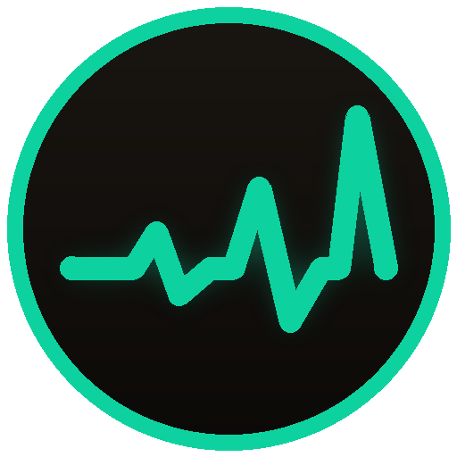

# Crescendo

**Never miss a ramp. Your healing plan, shown and spoken at the right moment.**

---

Healing a raid boss means pressing the right cooldown at the right second, and starting a ramp several global cooldowns before that. Crescendo keeps the plan for you: say which ramp, cooldown or trinket goes on which boss ability, and during the fight it shows and speaks every step leading up to it, timed from the bars of BigWigs or DBM.

## Features

- **Plan per boss ability.** "Power Word: Barrier 3 sec before Spectral Coils, casts 2 and 4", per stage or for every stage.
- **Ramps step by step.** Setup, ramp and press reminders for Discipline, Preservation, Restoration Druid and Restoration Shaman, with starter ramps from the Midnight guides. Holy Priest and Holy Paladin plan their cooldowns as spells.
- **Shown and spoken.** Icon, bar or text reminders you can move anywhere, text to speech, sounds, and a spoken countdown to each press.
- **Timeline of your pulls.** Every pull is recorded, so you can see each cast of each ability, drag through the fight, replay it on a target dummy and spot cooldowns that won't be ready.
- **Auto-plan.** Pick the abilities to cover and the cooldowns to use, and Crescendo spreads them over the fight without cooldown clashes.
- **Share with your raid.** Send plans to your group in game, or as a string. MRT notes are read and written too.
- **Checks before the pull.** A ready check line with what is wrong with your plan, and a review after each pull of what didn't show and why.
- **Profiles.** Share plans between characters or give each its own.

## Supported game versions

| Game version | Patch |
| --- | --- |
| Retail (Midnight) | 12.1.0 / 12.1.5 |

Bosses: The Venomous Abyss, The Unbinding of Kith'ix and Nymrissa Wavecaller, plus the season 1 raids (The Voidspire, The Dreamrift, March on Quel'Danas). BigWigs or DBM is needed for the boss timers.

## Installation

**With the CurseForge app (recommended):** search for **Crescendo** and click *Install*. Updates arrive automatically.

**Manually:**

1. Download the latest `Crescendo-vX.Y.Z.zip` from [GitHub Releases](https://github.com/xibate/Ramp-helper/releases).
2. Extract it into `World of Warcraft\_retail_\Interface\AddOns\`.
3. You should end up with `Interface\AddOns\Crescendo\Crescendo.toc`.
4. Restart the game or type `/reload`.

Coming from Zynx Ramp Helper, the addon's old name: delete the old `ZynxRampHelper` folder, and to keep your plans and ramps rename `WTF\Account\<account>\SavedVariables\ZynxRampHelper.lua` to `Crescendo.lua` while the game is closed.

## Getting started

Type `/cres` or click the addon button on the minimap. The first time, a short setup guide walks you through your boss mod, the voice, where the reminders show and your first plan. Everything else is in the [guide](docs/Guide.md).

## Credits

Made by **Xibate** and **Zynx**.

Found a bug or have an idea? [Open an issue](https://github.com/xibate/Ramp-helper/issues).
